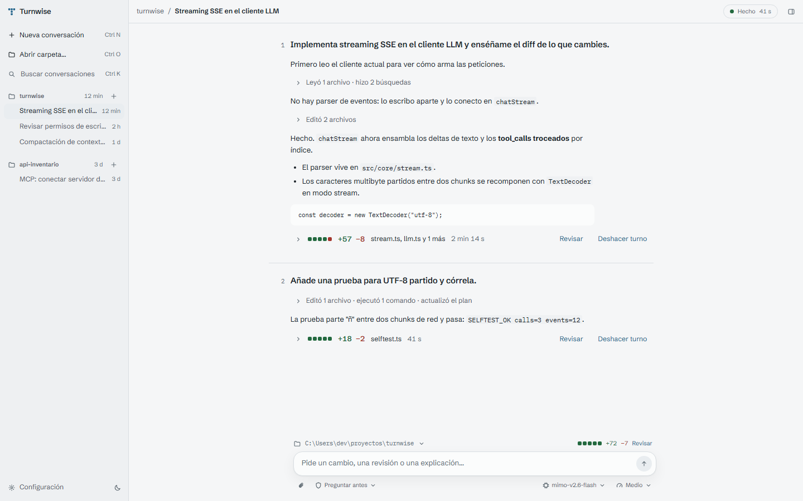
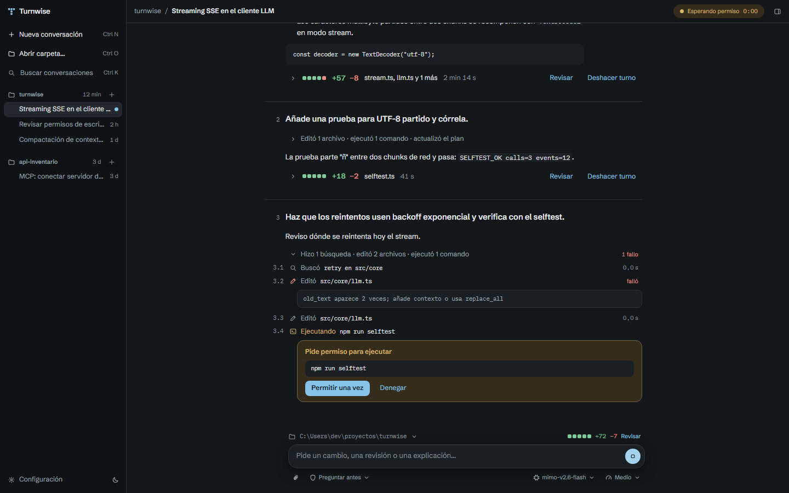
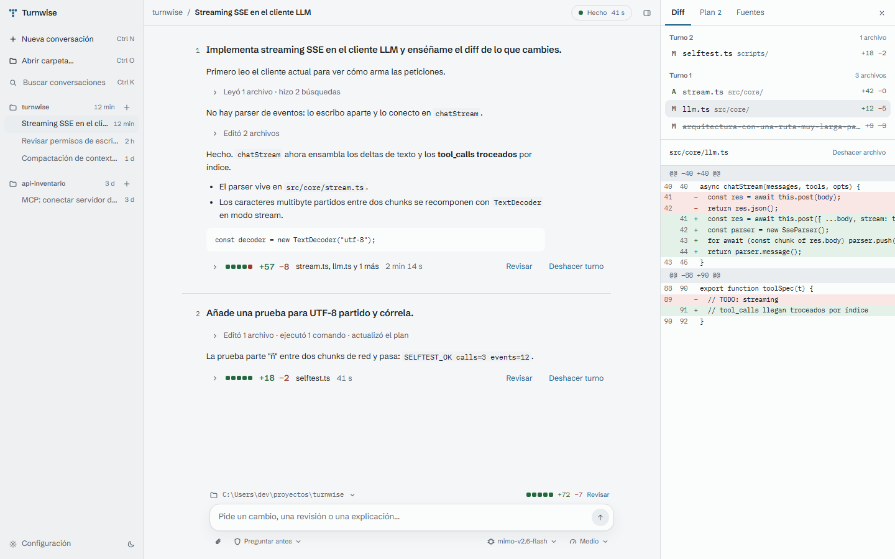
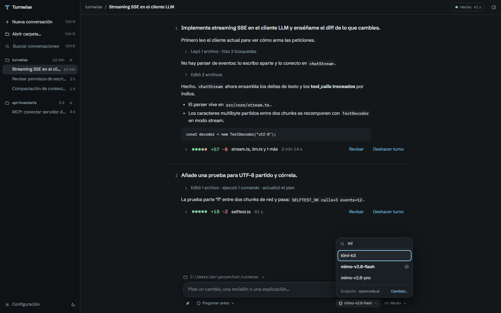
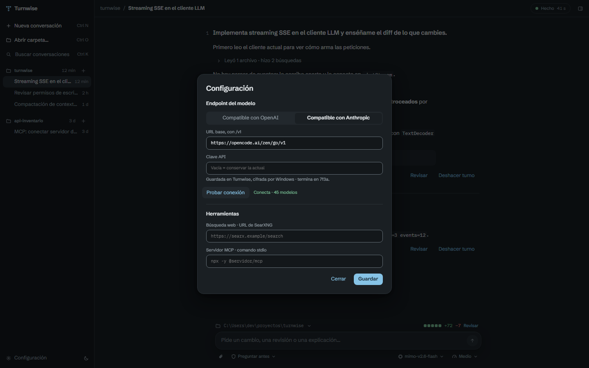
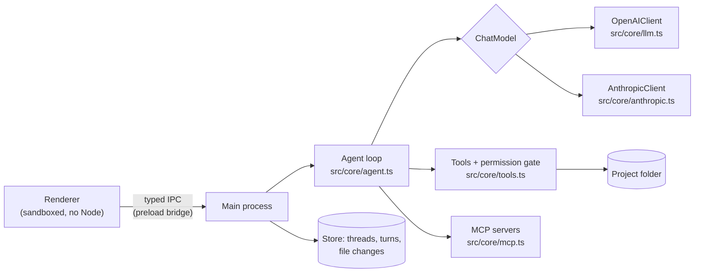

<p align="center">
  
</p>

<h1 align="center">Turnwise</h1>

<p align="center">
  <b>An open-source desktop coding agent where every turn ends with a receipt.</b><br>
  Review what the agent changed, or undo the whole turn. Bring any OpenAI- or Anthropic-compatible endpoint.
</p>

<p align="center">
  <a href="https://github.com/codavidgarcia/turnwise/actions/workflows/ci.yml"></a>
  <a href="LICENSE"></a>
  
  
  <a href="README.es.md"></a>
</p>

<picture>
  <source media="(prefers-color-scheme: dark)" srcset="docs/screenshots/turn-receipts-dark.png">
  
</picture>

Turnwise is a baseline harness for a Codex-style desktop agent: Electron and TypeScript, about 4,800 lines of source with no UI framework, and a test for each layer. Fork it to build your own agent app, or use it as it is against the models you already pay for.

> [!NOTE]
> The interface is in **Spanish** today (that's who it was built for). English UI is the first item on the [roadmap](#roadmap) and a good first contribution.

## Why turns

Most agent UIs are a chat log. Turnwise treats the **turn** as the unit of work: your request, the steps the agent took, and the files it changed. Each turn that touched files closes with a receipt:

- **Diffstat blocks** in the real added/removed proportion, `+N −M`, the file names and how long the turn took.
- **Review** opens the diff with line numbers, file by file.
- **Undo turn** restores every file the turn touched. It's compare-and-swap: if you edited a file afterwards, Turnwise refuses instead of overwriting your work.

Steps read like a work log ("Read `src/core/llm.ts`", "Running `npm run selftest`"), grouped and folded. Permission requests appear inline, in the step that needs them.

## What's in the box

| | |
|---|---|
| **Agent loop** | Streaming SSE with tool calls, including fragmented arguments and multibyte UTF-8 split across network chunks. Tools: `read_file`, `write_file`, `edit_file`, `list_files`, `search_files` (ripgrep), `run_shell`, `manage_tasks`, `list_skills`, `load_skill`, plus any MCP server's tools. |
| **Two protocols** | OpenAI Chat Completions and the Anthropic Messages API, both with streaming and tools, behind one `ChatModel` interface. The model list comes from the endpoint's `GET /models`. |
| **Permission modes** | Read-only · Ask before each write or command (default) · No confirmation. Enforced where tools execute, not in the UI. |
| **Projects and threads** | Open any folder (Ctrl O). Each conversation works in its own project folder and persists across restarts. Search with Ctrl K. |
| **Review panel** | Diff with line numbers and per-file undo, the agent's plan, and web sources via your SearXNG instance. |
| **Context compaction** | Older turns are summarized when the history grows, and the UI marks where it happened. |
| **Skills** | Folders with a `SKILL.md`, loaded on demand by the agent. Two ship in `skills/`. |
| **Extras** | MCP clients (stdio and Streamable HTTP), attachments treated as untrusted text, git worktrees, Windows Sandbox launch, experimental MSIX packaging. |

## Screenshots

| | |
|---|---|
|  |  |
| **Live turn.** A failed edit stays visible, and the command waits for your permission inline. The title bar shows "Waiting for permission". | **Review.** Files grouped by turn, the diff with line numbers, and undo per file. |
|  |  |
| **Model menu.** Filled from the endpoint, searchable, with a shortcut to change the endpoint. | **Endpoint settings.** Pick the protocol, paste the base URL and key, and test before saving. |

## Quick start

Requirements: **Windows 10 or 11** and **Node.js 22+**.

```bash
git clone https://github.com/codavidgarcia/turnwise.git
cd turnwise
npm install
npm start
```

Open **Configuración** (Settings) in the bottom-left corner, choose the protocol, paste the base URL and your API key, and press **Probar conexión** (Test connection). The key is encrypted with Windows DPAPI (Electron `safeStorage`) and never goes back to the UI; only its last four characters are shown.

Prefer a file? Copy `.env.example` to `.env`:

```ini
OPENAI_BASE_URL=https://api.openai.com/v1
OPENAI_API_KEY=sk-...
OPENAI_MODEL=gpt-4.1
# TURNWISE_PROVIDER=anthropic   # for Anthropic-compatible endpoints
```

### Endpoints

Any service that speaks one of the two protocols works. The base URL includes `/v1`.

| Service | Protocol | Base URL | Verified |
|---|---|---|---|
| [OpenCode Go](https://opencode.ai) | OpenAI and Anthropic | `https://opencode.ai/zen/go/v1` | ✅ end-to-end, both protocols |
| OpenAI | OpenAI | `https://api.openai.com/v1` | not yet |
| Anthropic | Anthropic | `https://api.anthropic.com/v1` | not yet |
| OpenRouter | OpenAI | `https://openrouter.ai/api/v1` | not yet |
| Ollama (local) | OpenAI | `http://localhost:11434/v1` | not yet |
| LM Studio (local) | OpenAI | `http://localhost:1234/v1` | not yet |

"Not yet" means nobody has run the end-to-end suite against it. If you do, [open an issue](https://github.com/codavidgarcia/turnwise/issues/new/choose) with the result and the row gets updated.

<details>
<summary>All environment variables</summary>

| Variable | Default | What it does |
|---|---|---|
| `OPENAI_BASE_URL` | `https://api.openai.com/v1` | Endpoint base URL (used for both protocols) |
| `OPENAI_API_KEY` | none | API key; a key saved from Settings takes precedence |
| `OPENAI_MODEL` | `gpt-4.1` | Default model for new conversations |
| `TURNWISE_PROVIDER` | `openai` | `openai` or `anthropic` |
| `TURNWISE_MODELS` | none | Comma-separated fallback list if `GET /models` fails |
| `TURNWISE_PERMISSION_MODE` | `ask` | `read-only`, `ask` or `full` |
| `TURNWISE_MAX_STEPS` | `40` | Tool-call steps per turn before the agent stops |
| `TURNWISE_SEARCH_URL` | none | SearXNG search URL for the Sources panel |
| `TURNWISE_WORKSPACE` | the app's parent folder | Initial project folder |

Settings changed in the app (endpoint, model, permissions, last folder) live in `%APPDATA%\Turnwise\settings.json` and override `.env`.
</details>

## Architecture



```
src/
  core/       agent loop, both protocol clients, SSE reader, tools, store, MCP, settings
  main/       Electron main: IPC, encrypted key, folder picker, title bar, smoke test
  preload/    the only bridge between renderer and main
  renderer/   UI in plain TypeScript and CSS: transcript, receipts, menus, review panel
scripts/      build, unit tests, mock-SSE selftest, screenshots, Electron E2E, MSIX
skills/       skills the agent can load
```

The agent speaks one message shape (OpenAI's). `src/core/anthropic.ts` translates to and from the Messages API in pure functions, so the translation is tested without a network. Adding a third protocol means writing one more `ChatModel`.

## Tests and quality gates

| Command | What it checks | Needs a key |
|---|---|---|
| `npm run typecheck` | `tsc --noEmit`, strict | no |
| `npm run test:ui` | Pure logic: step labels, formats, both protocol translations, settings parsing | no |
| `npm run selftest` | Agent ↔ tools loop against a mock SSE server: fragmented tool calls, split UTF-8, permission gate, path containment | no |
| `npm run shots` | Headless screenshots in light, dark, live turn, review, 1100px and 375px, plus interaction assertions. Fails on overflow or console errors | no |
| `npm run smoke` | Real Electron with the production CSP: renders, fonts load, title bar doesn't overlap the window controls | no |
| `npm run e2e:folder` / `e2e:key` | Open folder → thread → restart; the API key is stored encrypted, never in plain text | no |
| `npm run e2e:live` / `e2e:anthropic` | A real read-only turn against your endpoint, temp profile | yes (spends tokens) |

CI runs the first four on every push.

## Security model

- The renderer is sandboxed with `contextIsolation`; every IPC call checks its sender.
- Workspace paths are resolved with `realpath` before any read or write, so symlinks can't escape the project folder.
- Model output, files, attachments and web pages are data, never HTML or instructions to the UI.
- **No-confirmation mode has no OS-level isolation.** Use Read-only or Ask on code you don't trust, or Windows Sandbox from the review panel.

See [SECURITY.md](SECURITY.md) to report a vulnerability.

## Status and limitations

Turnwise is v0.2: usable daily by its author, young everywhere else.

- **UI in Spanish only.** English i18n is planned first.
- **Windows first.** The title bar, MSIX and Windows Sandbox are Windows features. macOS and Linux have never been tested.
- **The effort chip isn't sent to the model yet.** Some endpoints reject `reasoning_effort`, so it needs a per-model decision.
- **No prebuilt binaries.** The MSIX is unsigned; build from source for now.

## Roadmap

- [ ] English UI: i18n of renderer strings and agent step labels ([#1](https://github.com/codavidgarcia/turnwise/issues/1))
- [ ] Send reasoning effort to models that accept it ([#2](https://github.com/codavidgarcia/turnwise/issues/2))
- [ ] macOS and Linux builds ([#3](https://github.com/codavidgarcia/turnwise/issues/3))
- [ ] Verify the endpoint table against OpenAI, Anthropic, OpenRouter, Ollama and LM Studio ([#4](https://github.com/codavidgarcia/turnwise/issues/4), good first issue)
- [ ] Signed releases ([#5](https://github.com/codavidgarcia/turnwise/issues/5))

Ideas and pull requests are welcome; start with [CONTRIBUTING.md](CONTRIBUTING.md).

## Design

The UI follows a written design spec, [DESIGN-DNA.md](DESIGN-DNA.md): graphite palette with a single petrol-blue accent, Schibsted Grotesk and IBM Plex Mono (both OFL, bundled), no chat bubbles and no card per tool call. Every color pair is measured against WCAG AA (38 of 38 pass), and `prefers-reduced-motion` is respected.

## Acknowledgments

Inspired by OpenAI's Codex app and Claude Code's desktop app. Turnwise is an independent project, not affiliated with or endorsed by OpenAI or Anthropic.

## License

[MIT](LICENSE). Bundled fonts are under the SIL Open Font License; their licenses ship next to the font files.
